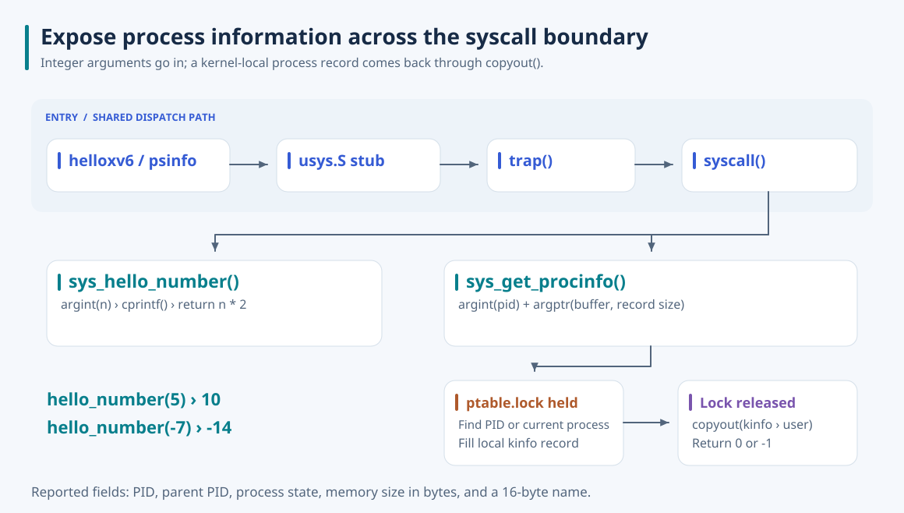

# xv6 Process Inspection Syscalls

**Give user programs a small, explicit interface to kernel-owned process state.** I added `hello_number` to exercise integer arguments and return values, then `get_procinfo` to validate a user buffer and copy a process record across the user/kernel boundary.

A user program cannot inspect the kernel's process table directly. The interface needs to identify a process, read its state while the table is protected, and return a bounded record without exposing kernel pointers. I implemented that path and added two shell commands to exercise successful calls and missing-process errors.



## Capture a process record

`get_procinfo(pid, buffer)` returns PID, parent PID, state, address-space size in bytes, and a 16-byte name. A positive PID selects a matching process-table entry; a non-positive PID selects the caller. Missing or unused entries fail with `-1`.

I validate the integer argument with `argint` and the user buffer range with `argptr`. Under `ptable.lock`, the handler finds the entry and fills a local `k_procinfo` structure. It releases the lock before calling `copyout` on the caller's page table. This keeps the table traversal separate from the user-memory transfer and avoids returning a live kernel structure or retaining its pointer after unlocking.

The user and kernel structures have matching layouts, but they are declared separately. The record is a bounded observation, not a live view or a transaction over every process field: other xv6 paths do not necessarily update all fields under `ptable.lock`.

## Exercise the complete dispatch path

`hello_number(n)` validates an integer, prints it in the kernel, and returns `n * 2`. The `helloxv6` command calls it with `5` and `-7`, demonstrating positive and negative integer transport without adding a complex subsystem.

Both calls are wired through the declaration in `user.h`, the assembly stub in `usys.S`, a number in `syscall.h`, the dispatch table in `syscall.c`, and a handler in `sysproc.c`. The saved `eax` carries the syscall number into dispatch and the return value back to user space. The implementation uses IDs 22 and 23 for `hello_number` and `get_procinfo` respectively.

## Run it

Use Linux or WSL with Make, an x86 compiler supporting 32-bit output, binutils, and QEMU. Validation used GCC 9.

```bash
cd xv6-public
make CC=gcc-9 xv6.img fs.img
make CC=gcc-9 CPUS=1 qemu-nox
```

At the xv6 shell:

```text
helloxv6
psinfo
psinfo 1
psinfo 9999
```

The fresh QEMU run returned `10` and `-14` from `hello_number`, retrieved caller and init process records, and printed `psinfo: failed (pid=9999)` for a missing PID. PIDs and memory sizes depend on the running image. Exit QEMU with **Ctrl+A, then X**.

The current `psinfo` display has a formatting defect: its format string requests both `SZ` and `NAME`, but its argument list omits `info.sz`. In the fresh run, `NAME` appeared as `(null)` and `SZ` was not a valid size. Those display fields cannot be used to validate the copied data until the command is corrected. The kernel handler and command are documented as they exist; the README does not treat a completed demo as proof that every displayed field is correct. The kernel arithmetic also has no signed-overflow check for extreme `hello_number` inputs.

## Read the implementation

The main boundary logic is in [sysproc.c](xv6-public/sysproc.c). The ABI is in [user.h](xv6-public/user.h), and dispatch wiring is in [syscall.c](xv6-public/syscall.c), [syscall.h](xv6-public/syscall.h), and [usys.S](xv6-public/usys.S). The commands are [helloxv6.c](xv6-public/helloxv6.c) and [psinfo.c](xv6-public/psinfo.c).

The SVG adds a visual explanation of the report's argument, locking, and copy paths; the report itself contains code and execution screenshots rather than a standalone call graph. Its original Word file and screenshots are not included. Labels use outlined Noto Sans with the [font license](docs/assets/NotoSans-OFL.txt). Upstream xv6 information remains in [xv6-public/README](xv6-public/README); see the [collection](https://github.com/jaeunda/xv6-kernel-extensions) for the other extensions.
